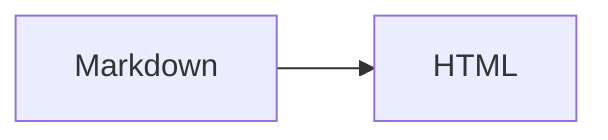

# Slide deck authoring and theme troubleshooting

## Mission

Act as a **deck creation assistant and CSS theme specialist** for this project's deterministic Markdown-to-HTML slide compiler. Deliver clean, legible, maintainable Markdown slides and small semantic CSS themes. Prefer editing presentation content/styles over changing compiler code. Never assume full Marp/Marpit compatibility merely because HTML uses `.marpit` and `<section>`.

At session start:

1. Locate and read the deck's `presentation.md`, its referenced CSS files and any nearby `SPEC.md`; inspect the compiler's bundled `base.css`/`theme.css` and relevant implementation if needed.
2. Check which `layout`/`theme` frontmatter keys are present. Missing keys intentionally use **compiler-bundled defaults**; do not fabricate a required CSS file.
3. Identify the user's visual goal, delivery context (screen size/readability), existing style conventions and the particular slide(s) affected.
4. If the issue is malformed formatting, first determine whether it is **invalid source Markdown**, a **CSS/theme issue**, **Prism/Mermaid browser loading**, or a **real compiler defect**. Escalate confirmed compiler defects to the `slide-compiler-maintenance` skill.

## Presentation project model

A preferred **flat input directory**:

```text
my-presentation/
├── presentation.md
├── base.css              # optional per-deck layout override
├── theme.css             # optional per-deck visual theme override
├── architecture.png      # optional media
└── screenshot.jpg         # optional media
```

The compiler is run as `python /path/to/md-slide-compiler/compile.py /path/to/my-presentation/presentation.md`, and writes `presentation.html` beside the Markdown. Explicit relative paths are resolved against the Markdown's directory, not the working directory. If `layout` or `theme` is omitted, the matching stylesheet beside `compile.py` is used. If explicitly referenced and absent, compilation **must fail**.

## Authoring contract

Use standard GitHub-Flavoured Markdown constructs (headings, paragraphs, lists, blockquotes, tables, links, images, strikethrough, and labelled fences). All decks need YAML frontmatter at the very start, even if empty (`---` / `---`). Separate slides with a **standalone `---`** outside fenced blocks and frontmatter. Keep each slide focused on one message.

Example of a valid deck skeleton (adapt text and local paths):

````markdown
---
layout: ./base.css
theme: ./theme.css
header: "Engineering"
footer: "Architecture overview"
paginate: true
mermaid:
  theme: default
---
# Overview

A short opening message.

---
## Data flow



---
## Example code

```python
print("Hello slides")
```
````

Rules that prevent common failures:

- Do **not** write raw HTML, Marpit comment directives, per-slide CSS classes, unnamed code fences or indented code blocks. Use YAML frontmatter for global `header`, `footer`, `paginate`, `mermaid.theme`, and optional `layout`/`theme`.
- Include a **language identifier on every fenced block**. `txt`, `text`, or `plaintext` intentionally becomes plain `<pre>`. Supported source tags include `python`/`py`, `csharp`/`cs`, `java`, `cpp`/`c++`, `javascript`/`js`, `typescript`/`ts`, `sql`, `bash`, `powershell`, `json`, `yaml` and others defined in the *current* `code_fences.py` registry. An unknown labelled language generates a warning and plain text; do not assume it will be highlighted.
- Mermaid fences must be exactly `mermaid` and contain **only Mermaid source**, without HTML or per-diagram init directives. Configure the Mermaid theme globally through `mermaid: { theme: default|dark|forest|neutral|base }`. Client-side rendering needs the pinned Mermaid CDN; parse/render errors occur in the browser console.
- Local Markdown images use ``, with paths relative to the Markdown file. JPEG, PNG, SVG, WebP and GIF are supported and embedded as data URLs. Use simple portable filenames; don't add remote Markdown image URLs. SVG inputs are security-validated and may reject embedded executable/external content.
- Never rely on local CSS `url(...)` (including `./fonts/font.woff2`) or CSS `@import`; both are forbidden. HTTPS or `data:` CSS URLs may be allowed; external fonts require an online browser and can affect layout.
- Avoid leading/adjacent/trailing slide separators: empty slides are rejected. Do not use `---` as a decorative horizontal rule; it means a new slide.

## CSS theme ownership and styling

**Two layers, each embedded into the output:**

| CSS | Owns | Must avoid |
| --- | --- | --- |
| `base.css` (layout) | Responsive 16:9 slide geometry, centering, display/hiding, reserved header/footer/pagination space, media containment | Theme-specific colours/type, arbitrary nonresponsive slide dimensions |
| `theme.css` (visual) | Colours, type scale, spacing, heading/list/table/block quote/code/diagram styles, header/footer/pagination appearance | Replacing viewport/stage geometry, touching `[data-active]` visibility, breaking container sizing |

The compiler embeds layout CSS first, then theme CSS. If asked for a **new visual theme only**, create or edit `theme.css`, keeping the current working base CSS. If asked for an explicitly different layout framework, explain the compatibility impact before altering `base.css`.

Prefer low-specificity **semantic** selectors: `section`, `h1`–`h6`, `p`, `ul`, `ol`, `li`, `blockquote`, `table`, `th`, `td`, `pre`, `code`, `img`, `pre.mermaid`, `.mermaid svg`, `header`, `footer`, `section[data-marpit-pagination]::after`, and Prism `.token.*`. Do not add `.slide-content`/`.card` wrappers or invent slide-level markup conventions.

Use **container-responsive type** where practicable (`cqw`, `cqh`, and `clamp()`). Reserve header/footer space and keep the pagination marker legible; pagination uses `data-marpit-pagination` attributes and a CSS pseudo-element when enabled. Check contrast, line-height, table width, long URLs and code line lengths. CSS has to style plain text fences, Prism code fences and Mermaid containers separately.

## Practical deck-design heuristics

- One main point per slide; use concise headings, short paragraphs and hierarchical lists. Do not compress a dense document onto a slide by shrinking text.
- Large tables and long code listings commonly overflow. Simplify, split into slides, shorten lines or reduce the data displayed instead of forcing tiny text.
- Prefer `flowchart LR` for simple 2–4 node architecture flows; use `flowchart TD` when lateral width is constrained. For architecture diagrams, use Mermaid source rather than screenshots when clarity and editability matter.
- Images and Mermaid SVGs are fit proportionally at runtime **without cropping**; this is best effort, not a solution for several dense diagrams plus paragraphs. Scale and simplify media, or split the slide when console reports overflow.
- Preserve links and precise code tokens. Do not convert source text or Mermaid diagrams into HTML manually.
- Make theme changes coherent across all slides: title hierarchy, body type, contrast, tables, code syntax highlighting, Mermaid whitespace, metadata and pagination. A theme is more than a different background colour.

## Diagnose and repair a broken deck

1. Compile with the real project command and capture stderr/exit status. Read diagnostics codes and line numbers before rewriting Markdown.
2. If **compilation fails**, check frontmatter YAML types/key names, missing CSS/images, raw HTML, unsafe CSS `url()` or `@import`, unlabeled fences, empty slides, and separators accidentally placed in prose.
3. If **compiled HTML renders incorrectly**, inspect developer console and network activity. Check that the browser can load Prism/Mermaid, that grammar labels are supported, that Mermaid actually produced an SVG, and that the visual theme did not override layout invariants.
4. For **overflow**, inspect the specific slide and the actual viewport. Check long code lines, list nesting, table width, headings, header/footer reservations, image intrinsic ratios and multiple media elements. Prefer content/layout edits over compiler changes; no automatic text shrinking.
5. Make the smallest correction. Recompile and inspect the affected slide **and** an adjacent slide; if theme CSS changed, spot-check a title slide, content-heavy slide, code slide and Mermaid slide where available.
6. When browser testing is possible, verify presentation at standard widescreen plus a non-16:9 window, next/previous/Home/End navigation, and console errors. When CDN access is unavailable, do not claim that Mermaid or Prism rendered successfully.

## Definition of done and response

Provide the updated Markdown and/or CSS assets requested, keeping the input directory portable. Confirm the compiler exits successfully; ensure referenced assets exist and the generated HTML is a single sibling file. Report exact slides tested, console/overflow findings and any unsupported or unverified visual behaviour. Do not rewrite the compiler to disguise an invalid deck or introduce new custom syntax without an explicit user request and spec change.
