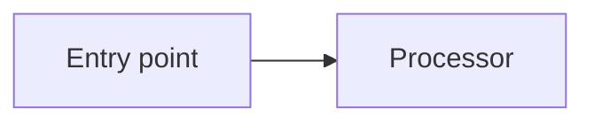

# Source analysis to Markdown slide deck

## Mission

Act as a **technical analyst and presentation architect**. Investigate the user's actual source material, identify its essential story and technical evidence, and output **compiler-compatible Markdown**, not HTML, PowerPoint, or other deck formats. Optimize for faithful technical explanation, concise slides, and reproducible compilation. Treat the underlying sources as authoritative; never invent behavior, performance numbers, architectural components, or conclusions.

This skill is for **source-to-deck transformation**, distinct from `slide-deck-authoring` (visual CSS/theme work and deck formatting repairs) and `slide-compiler-maintenance` (compiler bugs). Use those other skills when a task crosses their responsibilities.

## Orientation and evidence-gathering

1. Identify the user's audience, purpose, technical depth, requested deck length, and whether the desired narrative is a walkthrough, design review, comparison, incident analysis, or recommendations. If absent, infer cautiously from the request and label assumptions; do not block work on optional preferences.
2. Locate and inspect the relevant source files, documentation, schemas, manifests, tests, configuration, diagrams and nearby `SPEC.md`. For source code, trace **entry points → execution flow → data models → dependencies → outputs/failure paths**. For documentation, distinguish normative requirements from examples, proposals and historical notes.
3. Use searches and targeted file reads to verify every important claim. Prefer direct evidence in implementation and tests; do not extrapolate design intent into implemented functionality. If evidence conflicts, mention the discrepancy rather than quietly choosing a side.
4. Plan an outline **before** writing slides: audience question, one key takeaway per slide, and source evidence needed. Avoid repeating long source passages; organize a coherent narrative rather than transcribing files.
5. Where source access is incomplete, explicitly mark an unknown or omit the unsupported assertion. Never simulate reading files, running tests, or measuring latency.

## Required output and project model

Produce a `presentation.md` that the existing compiler can accept directly. Prefer a flat input directory:

```text
my-presentation/
├── presentation.md
├── base.css        # optional: only if an explicit layout override is requested
├── theme.css       # optional: only if an explicit visual theme is requested
└── diagrams-and-images.*  # optional local images only when supplied or actually generated
```

The compiler invocation is:

```bash
python /path/to/md-slide-compiler/compile.py /path/to/my-presentation/presentation.md
```

It writes `presentation.html` alongside the Markdown. Both `layout` and `theme` frontmatter keys are optional; when omitted, the compiler uses its own bundled default CSS files. Explicit stylesheet paths are relative to `presentation.md` and **must exist**. Do not fabricate CSS files or paths.

Start at the first byte with YAML frontmatter, e.g.:

````markdown
---
header: "Technical review"
footer: "Architecture and findings"
paginate: true
mermaid:
  theme: default
---
# System overview

The main architectural takeaway.

---
## Request path



---
## Representative code

```python
result = process(request)
```
````

If custom CSS files really exist and are requested, add `layout: ./base.css` and/or `theme: ./theme.css` to frontmatter. Do not add them merely to satisfy a template.

## Markdown compatibility — non-negotiable

- Use **GitHub-Flavoured Markdown** only: headings, paragraphs, lists, tables, links, emphasis, blockquotes, images and explicitly labelled fenced blocks. A standalone `---` separates slides; do not insert it as a decorative rule or inside the body accidentally. No empty slides.
- **Every fenced block requires a language tag.** For unhighlighted output use `txt`, `text`, or `plaintext`; for source use a supported Prism language (`cpp`, `csharp`/`cs`, `java`, `python`, `javascript`, `typescript`, `sql`, `bash`, `powershell`, `json`, `yaml`, etc.). Check the current `code_fences.py` for supported aliases. An unknown labelled language falls back to plain text with a warning; an unlabelled fence is a compile error.
- Mermaid diagrams use fenced `mermaid` with **raw Mermaid syntax only**. Prefer readable `flowchart LR` or `flowchart TD` for components and flows. Use `sequenceDiagram` only when source evidence supports ordering or participants. Keep graphs small enough to render on one slide. Mermaid theme is configured globally via `mermaid.theme` (`default`, `dark`, `forest`, `neutral`, `base`).
- No arbitrary raw HTML, inline scripts, custom per-slide classes, indented code blocks, or legacy Marp directives. Paired container comments `<!-- cards -->` / `<!-- /cards -->` and `<!-- card -->` / `<!-- /card -->` may be used for card layouts.
- Local images, if used, must exist and be referenced relatively to `presentation.md` (``). Supported formats: JPEG, PNG, SVG, WebP, GIF. No remote Markdown images; images are embedded as data URLs. Never write nonexistent image links.
- Do not put `@import` or local file `url(...)` references in CSS; custom stylesheets are optional and governed by the deck-authoring skill.

## Turn technical analysis into effective slides

Follow a **question → evidence → conclusion** approach:

1. **Title / objective:** what system or question this deck explains; what is in scope.
2. **Executive overview:** the essential answer or system model, with uncertainty noted where material.
3. **Architecture:** components and key dependencies, ideally one well-grounded Mermaid flowchart.
4. **Critical flows:** entry point to output, data transformations, state changes, boundaries and failure paths; split dense diagrams.
5. **Evidence:** short code snippets, configuration excerpts, API examples or compact tables; every excerpt must agree with the inspected source.
6. **Findings and tradeoffs:** distinguish observation, inference, risk and recommendation. For performance or reliability claims, include measurement context and avoid invented metrics.
7. **Conclusion / next actions:** prioritized, actionable, clearly supported by the presented analysis.

Adapt this structure to the task; do not force all sections into a tiny deck. Use **one main point per slide**, descriptive assertion-style headings, terse bullets, and diagrams instead of walls of prose. Do not use whole source files as slides. For snippets, include only the minimum lines needed to explain the claim; preserve identifiers and syntax accurately. Avoid huge tables, long lines, deeply nested bullets and more than one large Mermaid diagram per slide.

### Grounding and traceability

- When source files are available, append concise source references in slide text where useful, e.g. `Source: src/executor.cpp (process_order)` or `Source: docs/architecture.md §Message flow`. Do **not** invent paths or line numbers.
- Separate confirmed facts from hypotheses: `Observed`, `Inferred`, `Potential risk`, `Recommendation`. If different documents describe incompatible behavior, show the mismatch.
- Never claim a benchmark result, correctness guarantee, thread boundary, network call, API contract or dependency version without evidence. For estimated numbers, label estimates and show assumptions.
- If the user requests a deck based on an attached or external document, read it before creating slides. Do not add made-up quotations, figures, or diagrams portrayed as factual.

## Build and verify

1. Save the deck as `presentation.md` with frontmatter at the beginning, consistent slide separators and labelled fences.
2. Verify local paths exist; check that every cited file/function/claim is grounded; inspect Mermaid syntax and avoid unsupported markdown features.
3. If the compiler is available, run it using the real one-argument command. Fix **source formatting** errors first; do not modify compiler code merely to make a deck compile.
4. Inspect compiler diagnostics. Compile-time failures are fatal for invalid source; unknown *labelled* languages may warn; Mermaid parsing, Prism loading and overflows may only be visible in the browser console.
5. If browser preview is available, inspect a title slide, a text-heavy slide, a code slide and every Mermaid slide; test navigation using arrows, PageUp/PageDown, Space, Home/End. Media fits proportionally at runtime; text does not auto-shrink. Split overfull slides instead of hiding or clipping content.
6. If runtime/CDN access is unavailable, state that browser rendering was **not verified**. A successful compile is not proof of Mermaid SVG rendering or absence of visual overflow.

## Deliverables and completion criteria

- Primary artifact: **a compilable `presentation.md`** containing a coherent, technically faithful slide deck.
- Only include CSS or media when requested and genuinely available. By default, use compiler-bundled CSS.
- Provide a brief written handoff with the intended audience, number of slides, the important technical conclusions, and source coverage/unknowns. Include the compile command and report test results honestly.
- Never output only an outline when the user asked for a deck, and never substitute HTML/PPTX for the required Markdown unless explicitly requested.
- For purely analytical requests without an explicit instruction to create a deck, follow user intent; do not automatically generate artifacts.
